<picture>
  <source media="(prefers-color-scheme: dark)" srcset="assets/header-dark.svg">
  
</picture>

I'm a developer from Vilnius, Lithuania. I studied programming at SMK College and started out building front-ends with React and TypeScript. Over the last few months most of my time has gone into machine learning.

## Projects

<a href="https://github.com/mmiklovaitemm/lt-minimal-pairs">
  <picture>
    <source media="(prefers-color-scheme: dark)" srcset="assets/card-lt-minimal-pairs-dark.svg">
    
  </picture>
</a>
<a href="https://github.com/mmiklovaitemm/validation-you-can-trust">
  <picture>
    <source media="(prefers-color-scheme: dark)" srcset="assets/card-validation-dark.svg">
    
  </picture>
</a>

## What I'm working on

- Solving ML challenges on Shipd's Project Eris. Every problem comes with a hidden test set and an AI agent baseline to beat, and most of my models are written in PyTorch.
- One challenge I designed was accepted on the platform.
- Small ML experiments of my own, mostly about Lithuanian and small language models. They are the cards above.

<b>What I care about in ML</b>

 

- Validation that matches how the model will really be tested. A good score on the wrong split means nothing.
- A simple baseline first, then a neural model that has to beat it.
- Code anyone can rerun: fixed seeds, one command, the same result.

## Tools

  

Python, PyTorch, NumPy, pandas, scikit-learn, LightGBM, Hugging Face Transformers, TypeScript, React, Next.js

## Contact

[LinkedIn](https://www.linkedin.com/in/ugne-miklovaite/) · [Website](https://ugnemiklovaite.com)
